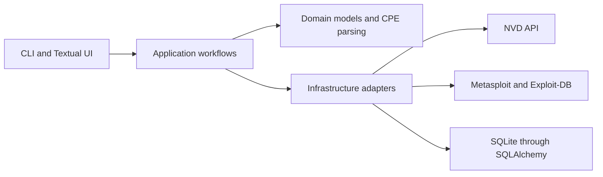

# db-manager

This package provides the asynchronous database updater and query command for
CVEScannerV2. Rich displays update progress and query tables. `db-query -i`
opens a Textual terminal interface; product names from the database are
available as input suggestions. Press the right
arrow to accept a suggestion, then press Enter or select Search.

## Architecture

The source tree separates interface code, application workflows, domain data,
and external-system access:

```text
src/db_manager/
├── cli/             Argument parsing, Rich output, and Textual UI
├── application/     Database update and query use cases
├── domain/          Validated data models and CPE parsing
└── infrastructure/  NVD, references, HTTP, query store, SQLite, and writer
```

The `db-manager` and `db-query` entry points are in `cli/database.py` and
`cli/query.py`. They call workflows in `application/`. Domain models describe
validated NVD data and typed database commands; infrastructure modules handle
service requests and persistence.



## Update behavior

The updater creates the schema before requesting data. For a new database, or
when its saved NVD timestamp is missing, invalid, or in the future, it fetches
the full catalog. Otherwise it requests modified records in date windows of
at most 119 days.

NVD pages are validated and fetched asynchronously. Vulnerable application
CPEs are converted to product identities and exact or ranged version records.
CVE updates and their associations are sent through a typed queue and persisted
by a single batched writer. For each changed CVE, old rows are removed before
the current record and references are rebuilt.

After NVD processing, the updater refreshes Metasploit module references and
optionally fetches Exploit-DB titles. Use `--noscrape` to skip title requests.
The NVD sync timestamp is saved after the update stages complete. HTTP 429 and
selected server errors are retried up to three times, honoring `Retry-After`.

## CVSS scores and schema

The `cves` table stores three scores: `cvss_v2`, `cvss_v3` and `cvss_v4`.
CVSSv4 is supported; NVD records without a v4 metric leave it empty.

`setup()` creates the schema for a new database. For a database created
before CVSSv4, it adds the `cvss_v4` column with `ALTER TABLE` when the column
is missing, so existing files keep working. The column is empty until the
database is updated and the records are re-imported.

`query` shows one `CVSS` column with the available scores, newest first
(`v4:9.3 v3:9.8 v2:7.5`); a CVE without scores shows `-`. The table no longer
has separate CVSSv2 and CVSSv3 columns.

## Performance

Importing raw pages (`--nvd-raw`) into an empty database (188 CPE pages and
209 CVE pages, 1.86 M CPEs and 416 k CVEs) takes 157-176 s instead of 228 s
on the reference machine (between 23 % and 31 % faster; timings vary
between runs). The schema and the stored data are unchanged.

- CPE names are split with a fast path when they contain no backslash escapes;
  criteria strings from CVE configurations are also cached, since about 87 %
  repeat.
- Page records are turned into commands as plain lists, without a temporary
  queue.
- The writer waits for the flush event instead of polling.
- Bulk inserts use SQLAlchemy Core instead of ORM bulk persistence, and each
  connection sets `synchronous=NORMAL`, a 256 MiB page cache, and in-memory
  temporary storage. The journal mode is not changed, so the database file
  stays readable in read-only mode by the scanner.

Overlapping page parsing with writes in a thread was tried and discarded: the
Python parsing holds the GIL, so it gave no measurable speedup and used more memory.
Further gains would need parsing in separate processes.

Without arguments, `db-query` prints its help; `-i` opens the Textual
interface and suggests product names from the database. Search results separate
exact-version matches from version ranges, apply inclusive or exclusive NVD
bounds and show known exploits in one `EXPLOITS` column (`EDB MSF`, `EDB`,
`MSF` or `-`). The one-off command (`-p`) also supports raw output and debug
logging for rejected comparisons.

Textual interface keys: `Tab`/`Shift+Tab` cycle product, version and update;
`Ctrl+S` searches, `Ctrl+L` clears, `Ctrl+E`/`Ctrl+R` show exact versions or
ranges, `Ctrl+T` focuses the results and `Ctrl+Q` quits. In a results table,
arrows, `hjkl` and `Ctrl+N/P/B/F` move the cursor; `g`/`G` or `Alt+<`/`Alt+>`
jump to the first/last row; `Ctrl+D/U` or `Ctrl+V`/`Alt+V` page down/up.

```bash
uv run --project db-manager db-query -p "gibbon" -v "25.0.0"
uv run --project db-manager db-query -p "gibbon" --raw --debug
```

From the repository root, install the package dependencies with:

```bash
uv sync --project db-manager
```

Then run either command from the repository root:

```bash
uv run --project db-manager db-manager --help
uv run --project db-manager db-manager
uv run --project db-manager db-manager --database data/cve.db --noscrape
uv run --project db-manager db-manager --nvd-raw data/nvd-raw
uv run --project db-manager db-query --help
uv run --project db-manager db-query -i
uv run --project db-manager db-query -c data/cve.db -p "gibbon" -v "25.0.0"
```

When working from this directory, the shorter commands are available:

```bash
uv run db-manager --help
uv run db-manager --noscrape
uv run db-query --help
uv run db-query -i
```

The database updater reads the NVD API key from `NVD_KEY` or `.api` in the
current working directory. From the repository root, it writes to
`data/cve.db` by default; use `--database` to select another database file.

Use `--nvd-raw DIR` to build the database from raw NVD pages saved earlier
(see [Store raw NVD pages](#store-raw-nvd-pages)) instead of querying NVD:

```bash
uv run db-manager --nvd-raw data/nvd-raw
```

No NVD API key is required in this mode, and NVD is not contacted for CVE or
CPE data. Metasploit and Exploit-DB remain online sources, so `--noscrape`
still applies to the Exploit-DB title requests.

Restart the same command with the same database to resume an interrupted
download automatically. Completed NVD pages and their query windows are
stored in SQLite; page data and checkpoints share a transaction. Progress
starts at the number of records already committed. Failures while fetching
Metasploit or Exploit-DB references do not discard NVD page checkpoints.

Live catalogue changes can require retrying pages whose offsets may have
shifted. Checkpoint tables are added automatically to existing databases.
Downloads interrupted before this feature was installed cannot recover page
boundaries from the existing product rows and must fetch those pages again
once. Do not delete the database to enable resumption.

## Store raw NVD pages
`db-manager` can keep the unmodified NVD API responses on disk so later
rebuilds and experiments do not need to call the API again. Pages are saved
under `data/nvd-raw/<endpoint>/<window>/page-<offset>.json`, next to a
`complete.json` marker for each finished window.

```bash
uv run --project db-manager python -m db_manager.cli.nvd_raw
uv run --project db-manager python -m db_manager.cli.nvd_raw --endpoint cves
uv run --project db-manager python -m db_manager.cli.nvd_raw --since 2026-01-31
```

Without `--since`, the script downloads a full snapshot in `full/`. With
`--since`, it downloads records modified since that UTC date in windows of at
most 119 days. Use the date of your previous run as the next `--since` value
so only new changes are requested. Completed windows and saved pages are
skipped, so rerunning the command after an interruption resumes it. The NVD
API key is optional here (it is read from `.api` or `NVD_KEY`), but without
one requests are spaced six seconds apart.
